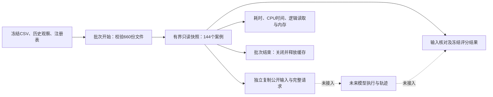

# 0.5.55-dev 版本内：架构、性能与能效边界

日期：2026-10-20。修订标识 within-version-performance-1，**不增加版本号**。原 cd8311e 版本660份冻结文件与旧评分不改；新增优化实现和证据单独登记。科学HOLD，API0，无模型/RL能力提升主张。

## 热点与优化后的分层

冻结参考入口保留在 termination555/core.py。cProfile 检查该文件的 qualify，发现 source 被调用439次、JSON解码1317次，重复读取、解析、复制占据主要时间。该剖析包含内部反例和注册重放，带探针开销，不能把其9秒直接与无探针基准对比。

| 层 | 当前职责与边界 |
| --- | --- |
| 冻结证据 | 原660文件及固定清单摘要；CSV、账本参考、私有评分真值不进入模型公开导出 |
| 批次装载 | BatchSnapshot.load逐文件流式核验，只保留源数据/注册表/输出模板所需字节；一次解析，重建并核对144个案例 |
| 批内计算 | 原始顺序的JSON文本供独立复制，避免共享可变dict；核对时精确比较规范JSON；常见stop/escalate分数从冻结评分器计算后缓存 |
| 异常与旧入口 | 其他决策仍调用原评分器；原core及audit完全保留作参考，新快照不覆盖它们 |
| 指标与复现 | 独立子进程成对比较，交替顺序；全量公开输入与完整评分摘要必须相同；新审计检查优化文件和冻结结果 |

这里使用缓存换取重复工作的减少，不是放弃验证。每个批次仍先读并验证约40.95MB冻结证据；批内不再反复读取约2.65GB逻辑文件内容。该读取量是Python返回给程序的字节，操作系统缓存可能已命中，不能说物理硬盘实际读了2.65GB。

## 生命周期与完整性

新入口是显式会话，不是全局永久缓存。推荐 `with BatchSnapshot.load() as batch:`；退出后缓存释放，后续调用拒绝。下一批次重新装载并验证。加载后文件变化不会暗中改变当前快照；新会话会发现不匹配。这是明确的时间点语义，不承诺自动监控工作区最新内容。

单个快照用于受控顺序批次；不支持并发close/use。若将来使用Go多worker，各worker应拥有自己的批次生命周期，不能仅凭本优化宣称分布式一致性。进程内任意代码能修改Python对象的威胁也不在此只读封装的安全保证内。

公开输入和评分结果每次返回独立对象。测试覆盖144个案例的stop、escalate及非法stage，与原实现逐项一致，包含输入JSON顺序一致；辅助删除、嵌套帮助、追加system和改token上限仍拒绝。相同观察但隐藏真值不同的案例仍不能凭哈希认证世界身份，相关false字段保持不变。

## 实测性能和内存

3组成对、交替顺序、全新子进程，在144个案例上执行相同 prepare → 原公开规则 → grade，并比较完整公开输入及结果摘要。时间包含快照验证与缓存构建，不含解释器/导入启动；操作系统文件缓存未清空。原参考每次API调用核对自身输入，新快照额外验证整个660文件集合，因此验证覆盖不是完全相同的微操作，比较的是两条等输出批处理路径。

| 中位数 | 冻结参考 | 优化快照 |
| --- | ---: | ---: |
| 批处理耗时 | 6.372秒 | 0.898秒 |
| 进程CPU时间 | 6.266秒 | 0.891秒 |
| 吞吐 | 22.60案例/秒 | 160.35案例/秒 |
| Path读取打开次数 | 2592 | 661 |
| 逻辑读取字节 | 2,645,730,864 | 40,952,366 |
| 峰值进程工作集 | 42.42MiB | 42.76MiB |

本机该工作负载约7.10倍提速，CPU时间减少85.8%，逻辑读取减少98.45%；峰值工作集增加约0.34MiB。内存不是零代价，也不能把单机3对结果当成跨机器统计结论。优化只涉及注册输入处理与评分，不能外推为全仓库、训练、模型API或整个历史审计都加速7倍。`--historical`仍执行原完整语义链，不用缓存分数假装重新运行了旧轨迹。

初步实现保留两套完整JSON表示，测得略高内存后已压缩为一套序列化缓存、核对时重建规范视图。最终指标来自最终实现的新一轮3对测试，早期测量只用于调试，不混入最终样本。原始样本、系统和测量限制见 paired_benchmark.json。

## 能效：实际测量与代理分开

本轮实测的是CPU时间、耗时、逻辑读取和进程峰值内存。CPU/整机焦耳数、节电百分比均为null，**不把85.8%的CPU时间减少称为节电85.8%**。后台功耗、CPU频率、系统负载和休眠尾部开销都可能影响电能。

本机 nvidia-smi 可读取 RTX 5070 Ti Laptop GPU 的瞬时功率，预检查约5.11W；这不是本批次CPU能耗，也没有积分成GPU焦耳。本轮没有模型推理，不触发GPU/NPU训练或推理；NPU能耗/吞吐未测。此前加速器路径保留，不能为了显示设备被使用而将小型JSON/哈希工作搬到加速器。

后续若要报告真实能效，需要与被测边界一致的CPU封装能量计或外接整机电表，保存带时间戳的采样、相同空闲基线、采样误差和完整批次起止，再分别报告总能量和扣空闲后的差异。不能用TDP乘CPU时间或孤立GPU功率样本伪造CPU焦耳。当前没有配置此类测量，不断言硬件永久不支持。

## 下一轮优化优先级

1. 当前先保留快照批处理及完整性/生命周期测试，收集不同批量规模、冷热启动和并发worker的真实瓶颈；不预设所有规模都能提速。单条调用继续保留原接口，不默认承担全批快照的固定装载成本。
2. C++只承接重新剖析后仍显著占时的数值内核，并先与Python逐项对照；本轮主要收益来自消除重复I/O，不新增无依据的原生绑定。
3. Go已有实验协调路径本轮不改。未来按证据修订和设备划分有限批次，避免每个案例都重复装载；跨进程缓存须有显式失效/版本键，不能沿用无限期全局缓存。
4. GPU/NPU仅在真实模型推理/训练需求及已有科学准入成立后比较吞吐、峰值内存和实际能量；不将工程加速解读为RL能力提升。

优化后剖析已单列 optimized_profile.json：主要剩余工作在批次load、深复制、文件核验及公开证据推导，尚未证明存在值得移植到C++/GPU/NPU的数值内核。下一步优先研究减少构建期对象复制及重复推导，同时保持精确参考对照；不把剖析探针时间与成对基准混算。

## 使用入口

- 快速优化复核：`python -m faultda_bench.termination555.performance_audit`
- 加上原完整历史语义链：上述命令追加 `--historical`
- 范围测试：`python -m unittest tests.test_faultda_termination555_runtime tests.test_faultda_termination555 -v`
- 重新测量：`python -m faultda_bench.termination555.benchmark --pairs 3 --output work/new_measurement.json`；输出必须为新文件，不覆盖本轮冻结样本。

新优化清单 performance555_v1.json 绑定实现、测试、报告与测量；原acceptance_v46和旧输出保持原样。清单只证明当前字节一致，不认证历史、环境身份、供应商输入或独立科学审阅。
