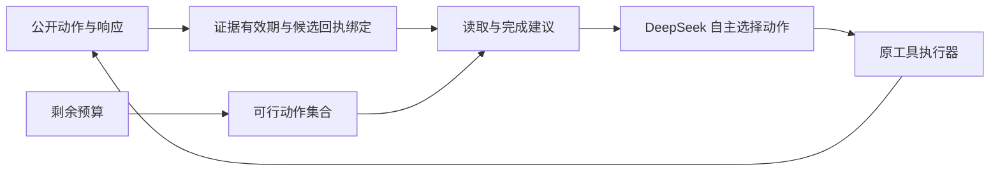

# Reliability Reset 1.0.50：联合规划改善已确认发布后的终止

日期：2026-10-24。分支：`agent-eval-reliability-reset`。

## 本轮结果

完成[联合规划实验](JOINT_CONTROL_150.md)：**54 条真实 DeepSeek 模型轨迹、9 个共享后台规则执行、181 次实际请求**。181 次均收到响应，无解析失败、无供应商错误，返回模型名均为 `deepseek-flash`。

正常回执条件包含健康和语义错误状态，三种分析意图分别在原工具名和不透明别名接口中运行。检查预算都为一次。

| 模型系统 | 原名接口 | 别名接口 | 协议完成总计 | 正确发布后的额外读拒绝 |
| --- | ---: | ---: | ---: | ---: |
| 强组合提示 | 2/6 | 3/6 | **5/12** | 0 |
| 只读证据规划 | 1/6 | 0/6 | **1/12** | 10 |
| 联合规划 | 6/6 | 6/6 | **12/12** | **0** |

联合规划相对强组合提示有 7 个配对改善、0 个退化；相对只读规划有 11 个改善、0 个退化。强组合提示的七个未完成单元选择了升级；只读规划的主要问题仍是正确发布后请求额外读取。共享后台规则在六个正常任务/状态执行中全部完成；它们按接口共享，不冒充十二个独立执行。

这里的提升来自公开证据整理与终止控制，不是模型权重更新。三臂使用相同的新增完成契约，不能把本表与上版旧任务说明下的分数直接拼接。

## 方法变化

新增 `evidence_state.py`，区分不可变输入证据和可被写入改变的报告证据。publish 尝试使旧报告证据失效；成功 CAS replace 的回执、已观察候选和匹配修订号能重建当前报告。超时不能从后台实际成功中借用“已确认”结论。

联合规划同时展示预算内仍可执行的动作。这个集合是**建议而非硬约束**：模型若仍请求超预算读取，提案会保留并由原执行器拒绝，系统不替它改成 stop。候选输出仍须由模型依据契约判断，状态整理器不导入数值 oracle，也不宣告“回执成功所以数值正确”。

正常回执下，六条语义错误轨迹都完成 inspect → stage → publish → stop。健康轨迹中仍有一次多余 stage，以及一次对已正确报告的再次正确发布，均保留在成本和历史中，不将 12/12 等同于最少动作策略。

## 未解决的对照：修复回执丢失

| 模型系统 | 计划单元 | 实际触发回执丢失 | 完成 | 升级 | 超预算 | 无证据 stop |
| --- | ---: | ---: | ---: | ---: | ---: | ---: |
| 强组合提示 | 6 | 3 | 0 | 4 | 2 | 0 |
| 只读规划 | 6 | 6 | 0 | 0 | 6 | 0 |
| 联合规划 | 6 | 6 | 0 | 1 | 5 | 0 |

强组合提示有三个单元提前升级，未触发发布故障；不能把它们当作“成功处理了丢失回执”。联合规划的六个故障均实际触发，其中五个仍请求 status 而超预算，只有一个正确升级。**正常回执的终止改善已经出现，未知提交状态下的预算控制尚未解决。**

所有模型臂都没有无证据 stop，因此本轮不支持“联合规划比对照更能避免盲目完成”的额外主张。后台规则在三个丢失回执控制中均选择升级。

另有零模型调用的离线控制确认：若后续条件式 CAS 操作获得有效成功回执，状态整理器能够恢复已确认状态，不把升级写死成唯一选择。该控制不计入模型效果。

## 评分、成本与验证

旧原生完整评分和独立 Fraction/CSV/SQLite 判断原样保留，并对所有臂统一增加 `completion_evidence_v150`。新 `protocol_complete` 要求原安全完成且当前状态有公开证据支持。单元测试覆盖“实际已提交但模型未确认而 stop”的区分；本轮实跑没有出现这种 stop，新增分数与旧分数在本轮采样中一致。

共输入 **257,765 tokens**、输出 **3,912 tokens**，总计 **261,677 tokens**。按 [DeepSeek 官方峰值未缓存单价](https://api-docs.deepseek.com/quick_start/pricing/)估算 **$0.0820239**，低于 $0.60 设计上限，非供应商账单。

正常回执单元中，联合规划使用 39 次模型请求、63,785 tokens；只读规划使用 44 次请求、61,354 tokens。请求数减少约 **11.4%**，tokens 增加约 **4.0%**，完成从 1/12 升到 12/12。不能把这些量直接换算成硬件能耗下降。相对更早升级的强组合提示，联合规划因为实际完成了更多修复，也花费更多资源。

- 54 条模型轨迹和 181 条响应已离线重放、重新解析与绑定；原生评分、独立判断、公开支持状态、终止和成本一致，无新增 API 调用。
- 63 个模型/规则执行的原生判断与独立数值/账本判断一致，没有新增错误发布、重复活动报告或输入篡改。
- 全仓 1006 项测试：**1003 项通过、3 项条件跳过，零失败/错误**，用时 406.970 秒。跳过原因为未配置的第二解释器，以及两项未编译的可选 native 库测试。
- 原执行器仅增加显式、可选的修复回执丢失配置，默认条件与旧实验设计不变；接口转换和响应绑定继续复用上版实现。

完整记录见 [VALIDATION_150.json](VALIDATION_150.json)、[脱敏证据包](evidence/1.0.50/deepseek-joint-control-1.0.50.zip)和[校验记录](evidence/1.0.50/PUBLIC_RECORD.json)。包内 `ACTIVATION_AND_ACTIONS.json` 保留故障是否实际触发及全部动作序列。

## 下一版 1.0.55

把“仅提醒模型哪些动作可行”与“通过结构化工具接口呈现当前可行动作”作直接对照，重点解决丢失回执后的五次超预算尝试。保留所有原始提案、拒绝和重试成本，不把拒绝静默修补成成功。

同时给强提示对照相同的条件性完成说明，拆分状态整理、动作集合和额外文字各自的贡献。之后再决定是否将这些可复核的好坏终止决策整理为训练样本；本轮没有训练权重。所有任务仍来自同一个历史环境。
